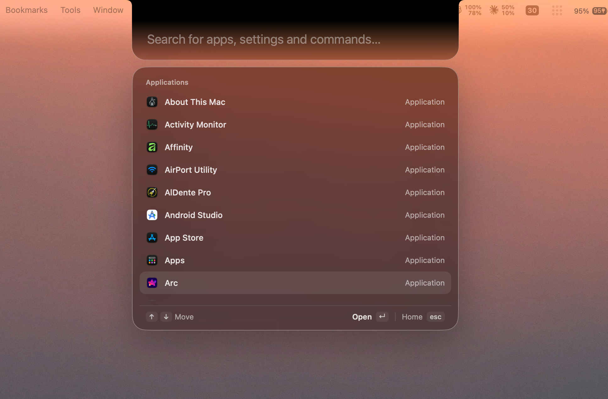
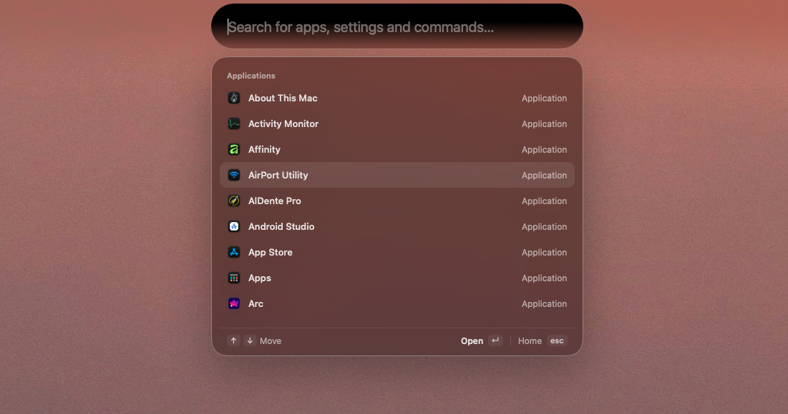

# Perch

**A native macOS launcher that lives in your notch. One hotkey, search, clipboard, live activities and your coding agents, all in one spot.**

<p align="center">
  
  
  <a href="LICENSE">
    </a>
</p>

SwiftUI and AppKit. On a notched MacBook the black shape grows out of the hardware notch. On an external display or in clamshell mode, a floating pill sits at the top centre and expands the same way.

<p align="center">
  
</p>

<p align="center">
  
</p>

## Features

- **Command panel**: fuzzy-search and launch apps, jump to System Settings panes, and get inline math and unit answers.
- **Global hotkey**: `⌥ Space` opens the panel from anywhere. Rebind it in Settings.
- **Clipboard history**: searchable, pasted back into the app you were using.
- **Drop to convert**: drag an image toward the notch and convert or resize it in one step.
- **Live activities**: one shared slot in the pill for timers, media, weather, calls (Meet and Zoom), notifications, AirDrop and dictation.
- **Coding agents**: Claude Code and Codex report progress and permission requests to the notch through the `perch` CLI.
- **Two screen modes**: notch on the built-in display, floating island on external displays. Switches live when you open or close the lid.

## Install

Perch is not yet published as a release. Build it from source (below).

## Building from source

Requirements: macOS 26 or later (macOS 27 recommended), Xcode 26 or later (Swift 6.2).

```sh
git clone https://github.com/iyansr/Perch.git
cd Perch
open Perch.xcodeproj
```

Run the `Perch` scheme. The Xcode build phase runs `Scripts/build-mediaremote-adapter.sh` for you.

Debug builds sign with your own Apple Development team. Release builds sign with a self-signed `Perch Self-Signed` identity; create it once with `./Scripts/create-signing-identity.sh`. See [docs/signing.md](docs/signing.md).

The marketing site lives in `web/` (Astro, pnpm):

```sh
cd web
pnpm install
pnpm dev
```

See [docs/PRD.md](docs/PRD.md) for the product spec and [docs/ACTIVITIES_PLAN.md](docs/ACTIVITIES_PLAN.md) for the activities design.

## Agent hooks

The `perch` command-line tool bridges coding agents and Perch.app.

```sh
perch event --source claude|codex [--await]   # hook command; reads the hook JSON on stdin
perch watch -- <command> [arguments…]         # run a command, report start and exit
```

`event` always fails open: if Perch is not running, the agent never notices.

## Third-party software

`Vendor/mediaremote-adapter` is [ungive/mediaremote-adapter](https://github.com/ungive/mediaremote-adapter), licensed under BSD-3-Clause. Its own license stays in `Vendor/mediaremote-adapter/LICENSE`.

## License

[AGPL-3.0](LICENSE)
