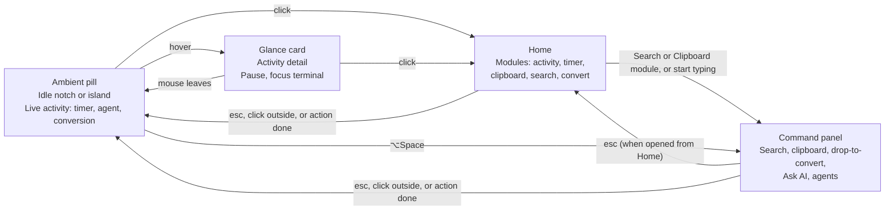

# Perch — PRD & User Journey

Oct 29, 2026 · @Iyan · v0.1

## Overview

Perch turns the MacBook notch into a command center: search, clipboard, file conversion, AI answers, and live status of your coding agents, all one gesture away. On an external display in clamshell mode, the notch becomes a floating island pill at the top of the screen.

**Problem.** Power users juggle a launcher, a clipboard manager, a file converter, an AI chat window and several terminal tabs to check whether an agent has finished. Each lives in a different place and steals focus.

**Why the notch.** It is the one spot on screen that is always visible, never covered by windows, and unused. It can show ambient status without a window, and expand into a full panel on demand.

**Differentiation.**

| Product | What it covers | Gap we fill |
| --- | --- | --- |
| Spotlight (macOS 26) | Search, actions, clipboard history | No live status, no file actions, no agent awareness |
| Raycast | Search, extensions, AI | Lives in a floating window, no ambient state |
| NotchNook / DynamicLake | Media, file shelf, AirDrop, calendar | No command panel, no clipboard, no agents |
| Pulse Island | AI agent status in the notch | No search, no file actions |

Our bet: the first notch app that combines a real command panel with live activities, and treats coding agents as first-class citizens.

## Goals, non-goals and success metrics

v0.1 is a 3-day build whose job is a launch demo on X and Product Hunt, not a complete product.

**Goals**

- Ship a native Swift + AppKit app with six features: search, clipboard history, live activities, drop-to-convert, Ask AI and agent status
- Feel instant: the panel opens in under 100 ms from hotkey or click
- Work on both a notched MacBook and an external display in clamshell mode
- Produce a 15–30 second demo video with three clear moments

**Non-goals for v0.1**

- Plugin or extension system
- Media controls, calendar, weather, AirDrop
- Video and audio conversion
- Windows or Linux support
- Mac App Store distribution (the sandbox blocks the notch window level and hooks)

**Success metrics (first 30 days after launch)**

| Metric | Target |
| --- | --- |
| Product Hunt upvotes on launch day | \[TARGET\] |
| Demo video views on X | \[TARGET\] |
| Downloads | \[TARGET\] |
| Users who open the panel 5+ times on day 2 | \[TARGET\] % |
| Users who connect at least one agent | \[TARGET\] % |

## Target users

The launch audience is developers who already run AI coding agents and live on the keyboard.

| Persona | Context | What they want from the notch |
| --- | --- | --- |
| Agent-heavy developer | Runs Claude Code or Codex in 2–4 terminals while doing other work | Know the moment an agent finishes or needs input, without tab-hopping |
| Clamshell desk worker | MacBook closed, external monitor, keyboard and mouse | The same quick panel on the big screen, plus laptop battery status |
| Designer / content maker | Moves screenshots and exports between apps all day | Drop a file, get it as JPG/PNG/WebP or resized in one step |
| Keyboard power user | Already uses a launcher and a clipboard manager | One hotkey for search, clipboard and quick AI answers |

## Core concept

The app has one surface with four states, and the same states work on both screens.

The pill is always there and shows live activities; hover peeks, click opens Home, the hotkey opens search directly, and every exit returns to the pill.

**Home.** Clicking the notch or island never lands in a text field. It opens Control Center–style modules inside the black surface: Activity (top three items, most urgent first), Timer (the running timer as a big clock, click to pause, or 5/25/50 min presets), Clipboard (newest clip), Search, and a dashed Convert well for drops. Clicking Activity zooms into the full list with actions; esc or "Home" shrinks it back into the module. The Search and Clipboard modules open the command panel, and esc there returns to Home. Typing any character in Home opens search with that character already in the field. Similar notch apps (Boring Notch, NotchNook, NotchMind, Droppy, NotchDude) also open content on click or hover rather than a search field.

**Screen modes.**

- **Built-in display:** the black shape grows out of the hardware notch, flush with the top edge.
- **External display / clamshell:** no notch, so a small floating pill sits at the top centre and expands the same way. macOS keeps menu bar icons out of a hardware notch but not out of the island, so when the icons reach under the centre the island steps left of them. Reading icon positions needs Accessibility; without it the island hangs just below the menu bar so it never covers icons.
- The app re-checks the screen whenever displays change, so closing or opening the lid switches modes live.

## Feature requirements

Every feature lives inside the same command panel or the same live activity slot, so the app stays one surface.

### F1. Command panel and search (P0)

- Opens with a global hotkey (chosen by the user at first launch, ⌥Space suggested), from Home's Search or Clipboard module, or by typing in Home. Clicking the notch/island opens Home, not search.
- Searches installed apps; ↵ launches, ↑↓ move, esc closes, click outside closes
- Searches System Settings panes by name or the settings they hold (`wallpaper`, `dock`, `dark mode`); ↵ opens the pane
- Chips switch mode: All, Apps, Clipboard, Files, AI
- Fallback rows: "Search the web for …" and "Search files for …" (opens Search Files with the query)
- Inline answers for math and unit conversion (`24*7`, `5 km to mi`)

Acceptance: panel visible within 100 ms; first keystroke lands in the field with no extra click; the frontmost app keeps its menu bar.

### F2. Clipboard history (P0)

- Records text, images and file references copied in any app
- Keeps the last 200 items or 7 days, whichever comes first
- Searchable from the Clipboard chip; ↵ pastes into the frontmost app, ⌘↵ copies only
- Skips items from password managers (concealed pasteboard types)
- One-click "Clear history"

Acceptance: an item copied in Safari appears in under 1 s; a password copied from a password manager never appears.

### F3. Live activities (P0)

One shared slot in the idle pill used by every long-running thing.

- Shows icon, short label and progress (ring, bar or spinner)
- Hover expands to a glance card with one or two actions
- Several activities stack; the most recent or most urgent shows first
- States: running, needs attention, done, failed; done/failed auto-dismiss after 8 s
- Built-in sources for v0.1: timers (`t 25m`), file conversions, agent sessions
- Post-v0.1 sources (media, HUDs, battery, calendar, calls, privacy chips, notifications, downloads, weather, dictation): see [ACTIVITIES_PLAN.md](ACTIVITIES_PLAN.md)

Acceptance: a 25-minute timer survives closing and reopening the panel; a finished activity plays a short animation and a sound (toggleable).

### F4. Drop-to-convert (P0)

- Dragging a file anywhere near the notch grows it into a drop zone
- Drop shows actions for the file type; v0.1 covers images only: convert to PNG / JPG / WebP / HEIC, resize to 50 %, compress
- Output is saved next to the original with a suffix (`photo-compressed.jpg`) and revealed in Finder
- Multiple files run as one batch with a single live activity

Acceptance: dropping a 4 MB HEIC and choosing JPG produces the file in under 2 s; the original is never modified.

### F5. Ask AI (P1)

- Press Tab in the search field to turn the query into a question
- The answer streams into the panel in Markdown; ⌘C copies it
- Bring-your-own API key (Anthropic or OpenAI), stored in the Keychain
- Optional context: the current clipboard item

Acceptance: first tokens appear in under 1.5 s on a normal connection; without a key the panel shows a one-step setup instead of an error.

### F6. Agent status (P1)

- Shows each running Claude Code / Codex session as a live activity: running, needs input, done, failed
- Glance card shows project folder and the last event; the row's Focus action brings the terminal app forward
- One-click "Connect Claude Code" writes the hooks config; Codex is set up the same way through its notify setting
- Generic wrapper for any tool: `notch watch -- <command>`

Acceptance: when Claude Code asks for permission, the pill changes to "needs input" within 1 s.

## User journeys

Each journey starts from the idle pill and ends back there, so the user never manages a window.

### J1. First launch (about 60 seconds)

1. User opens the app; the notch does a short "hello" pulse to show where it lives.
2. A small onboarding card drops from the notch with three steps: hotkey, permissions, connect agents.
3. User confirms ⌥Space or records their own hotkey.
4. App asks for Accessibility (needed to paste into other apps). Skipping it keeps copy-only mode.
5. "Connect Claude Code" and "Connect Codex" buttons; each shows what it will write to the config before writing.
6. Optional: paste an API key for Ask AI.
7. Card collapses into the notch with "Press ⌥Space anytime".

### J2. Search and launch

1. User presses ⌥Space; the notch springs open, the field is focused.
2. Types "fig"; Figma is the top hit after 3 letters.
3. ↵ launches it; the panel collapses back into the notch.

### J3. Paste something from earlier

1. User remembers copying an address an hour ago.
2. Clicks the notch and picks the Clipboard module, or presses ⌥Space then ⌘2 (Clipboard chip) or types `clip`.
3. Types "jalan"; the address appears.
4. ↵ pastes it into the frontmost app and the panel closes.

### J4. Convert a file by dropping it

1. User drags a HEIC screenshot from Finder toward the top of the screen.
2. The notch grows into a drop zone labelled "Drop to convert".
3. On drop, the panel shows: PNG, JPG, WebP, Resize 50 %, Compress.
4. User picks JPG; the pill shows a progress ring, then a check.
5. Finder reveals `screenshot.jpg` next to the original.

### J5. Ask a quick question

1. User types "regex for indonesian phone number" in the panel.
2. Presses Tab; the field turns into an AI prompt and the answer streams in.
3. ⌘C copies the answer; esc closes.

### J6. Agent needs input while the user is elsewhere

1. User starts a Claude Code task in Terminal and switches to the browser.
2. The pill shows a small pulsing dot: "Claude · api-server · running".
3. Claude Code asks for permission; the pill turns amber: "needs input".
4. User hovers; the glance card shows the project and the last event.
5. The row's Focus action brings the right terminal window forward. When the task ends, the pill shows a check for 8 s, then returns to idle.

### J7. Clamshell mode

1. User closes the MacBook lid with an external monitor attached.
2. The app detects no notch on the active screen and shows the floating island pill at the top centre.
3. Every journey above works the same; the panel opens from the island instead of the notch.
4. On reopening the lid, the app moves back to the notch without restarting.

## Technical approach

A single Swift app: AppKit owns the window and system plumbing, SwiftUI draws everything inside the panel.

| Component | Responsibility | Key APIs |
| --- | --- | --- |
| NotchPanel | Borderless, non-activating `NSPanel` above the menu bar; can become key for typing | `NSPanel`, `.nonactivatingPanel`, `CGShieldingWindowLevel()`, `canJoinAllSpaces`, `fullScreenAuxiliary` |
| ScreenManager | Picks the screen, detects notch vs no notch, re-positions on change | `NSScreen.safeAreaInsets`, `auxiliaryTopLeftArea`, `didChangeScreenParametersNotification` |
| HotkeyManager | Global open/close shortcut | Carbon `RegisterEventHotKey` or the KeyboardShortcuts package |
| SearchEngine | App index and fuzzy ranking | Scan `/Applications`, `NSMetadataQuery`, `NSWorkspace.open` |
| ClipboardStore | Polls the pasteboard and stores history | `NSPasteboard.changeCount` every 0.5 s, SQLite (GRDB) |
| ActivityCenter | Shared queue of live activities and their states | Swift `@Observable` model, SwiftUI animations |
| Converter | Image conversions on dropped files | `NSDraggingDestination`, `sips` via `Process` or ImageIO |
| AIClient | Streaming answers, key in Keychain | `URLSession` streaming, Security framework |
| AgentBridge | Receives events from coding agents | Local Unix socket; `notch` CLI bundled in the app |

**Agent integration.**

- Claude Code: the app adds hooks to `~/.claude/settings.json` for prompt submit, notification, stop and session end. Each hook runs `notch event --source claude --type <event>`, which sends a small JSON message over the socket.
- Codex: the app sets the `notify` program in `~/.codex/config.toml` to the same CLI.
- Anything else: `notch watch -- <command>` runs the command and reports start, exit code and duration.
- The app always shows a diff before writing a config and keeps a backup of the original file.

**Permissions.**

| Permission | Needed for | If declined |
| --- | --- | --- |
| Accessibility | Pasting into the frontmost app | Clipboard works in copy-only mode |
| Files & Folders (on drop) | Writing the converted file next to the original | Save to Downloads instead |
| Network | Ask AI only | Ask AI hidden |

**Distribution.** Signed and notarized DMG outside the Mac App Store, auto-updates with Sparkle. macOS 14 Sonoma or later.

## Build plan, risks and open questions

Day 1 decides the schedule: if the panel, focus and drag-and-drop work by its end, days 2 and 3 are feature work.

### 3-day plan

| Day | Build | Done when |
| --- | --- | --- |
| Day 1 | NotchPanel, ScreenManager, hotkey, open/close animation, app search, ActivityCenter with a timer | ⌥Space opens the panel on notch and island, an app launches, `t 1m` counts down in the pill |
| Day 2 | Clipboard history, drop zone, image conversion | Copy → find → paste works; a dropped HEIC becomes a JPG |
| Day 3 | AgentBridge + Claude Code hooks, Codex notify, Ask AI, demo recording | A real Claude Code session shows running → needs input → done; demo video recorded |

### Out of scope for v0.1

- Settings beyond hotkey, API key and agent connect buttons
- Video/audio conversion, AirDrop, media controls, calendar
- Multiple monitors showing islands at once (v0.1 follows the main screen)
- Localisation

### Risks

| Risk | Impact | Mitigation |
| --- | --- | --- |
| Panel can't take keyboard focus without stealing the menu bar | Search is unusable | `NSPanel` subclass with `canBecomeKey = true` and `.nonactivatingPanel`; test on day 1 morning |
| Drag over a 32 px notch is hard to hit | Drop-to-convert feels broken | Grow a larger invisible drop target along the top edge when any drag starts |
| Claude Code or Codex change their hook formats | Agent status stops updating | Keep the CLI thin; version-check on launch; `watch` wrapper as fallback |
| Clipboard history captures secrets | Trust and privacy | Skip concealed/transient pasteboard types; local only; clear button |
| Full-screen apps and Spaces hide the panel | Panel missing when needed | `canJoinAllSpaces` + `fullScreenAuxiliary`; test with a full-screen app |

### Open questions

- [ ] Final app name and icon
- [ ] Free for now (decided); revisit a Pro tier for Ask AI and agents after launch
- [ ] Default hotkey: user sets it at first launch (decided); ⌥Space is only the suggestion, since it may clash with other launchers
- [ ] Should the island follow the cursor across monitors in v0.2? No: main monitor only (decided)
- [ ] Show MacBook battery in the island when the lid is closed? Yes, but lowest priority (after v0.1)
